# Walkthrough: Project Bridgeline (proof of concept)

A high-level tour of what the prototype does, how it is built, and what is and is not real yet. Written for a quick read before a demo.

> Revision 8 (built, see the section 'On a phone' below): phone-first layout, a Help and FAQ sheet, Rejoin and Share invite. It supersedes the in-person parts of Revision 7. Sections 1-9 describe the prototype as it works today. Section 10 describes the Revision 6 plan (cut scenes, preset messages, recap banner, simpler story and roles), which is not built yet. Section 11 describes the Revision 7 plan (in-person huddles and six decisions), which changes parts of section 10 and is also not built yet.

## On a phone (Revision 8)

The event runs entirely on phones, with teams meeting anywhere, so there is no typing. Bottom tabs switch between **Game** and **Team** (a read-only feed with an unread badge). Players add to the feed by tapping a preset message or **Publish to team** on their own clue. **? Help** opens a FAQ from any screen. Roles are CEO, Product Lead, CTO, Quality Lead and Customer Lead.

| | |
| --- | --- |
| 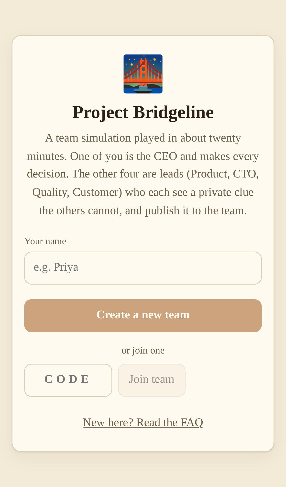 | 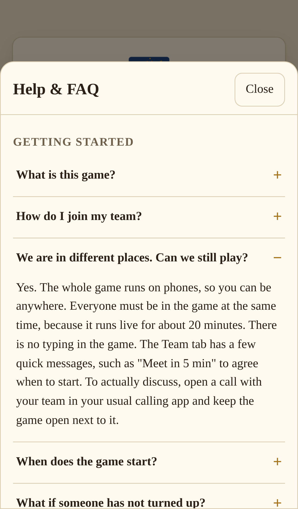 |
| 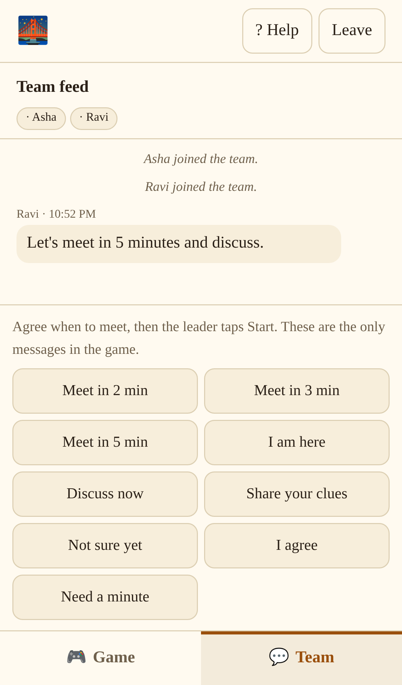 | 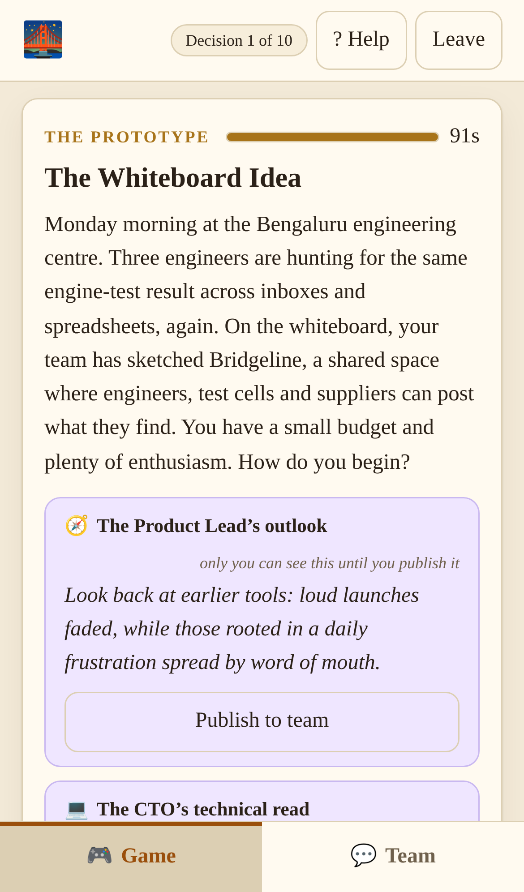 |
| 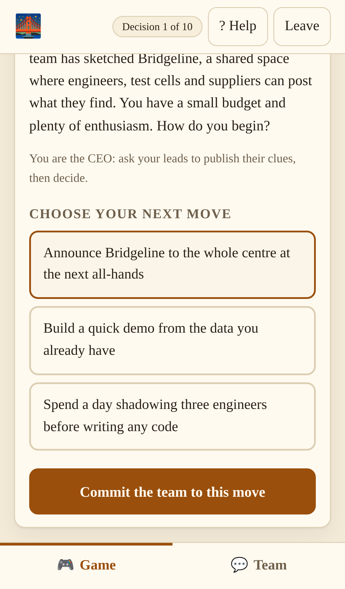 | 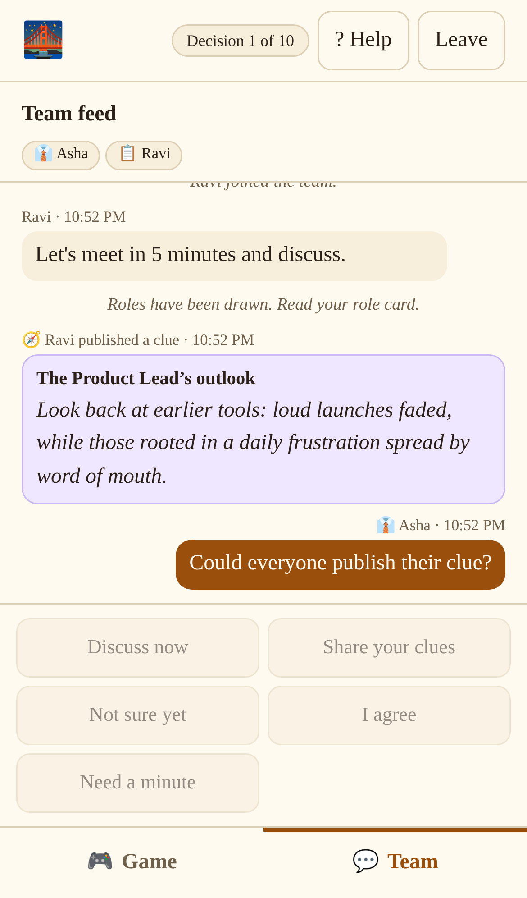 |

Checked on an emulated iPhone 13 with two phones on the real server: create and join by code, a meeting message in the lobby, publishing a clue, the CEO reading it, no text box anywhere in the feed, no sideways scrolling, the Commit button in view, Rejoin after a reload, and a 100-socket load test with preset messages (p95 delay 7 ms on localhost).

## 1. What it is

A team decision game for up to 5 players, played in about 20 minutes. One player is the **CEO** and makes every decision. The other players are **advisors**, and each advisor holds a private clue the others cannot see. They have to pass those clues on through team chat, in their own words, and decide whom to trust. The story is set at a fictional company, Halden Aerospace India: a small Bengaluru team must take an internal collaboration platform, Bridgeline, from a lab prototype to a company-wide rollout and win the Leadership Review. The advisors are a Foresight Analyst, a Field Engineer, a Quality Lead and a People Partner.

There is **no live AI** anywhere in this prototype. All story text is written in advance and stored in one file. That is deliberate: it keeps the live event cheap, predictable, and free to host.

## 2. A two-minute demo script

Use the in-browser demo (the GitHub Pages link or `docs/index.html`).

1. **Welcome screen.** Enter a name and start. Point out that four practice teammates join automatically.
2. **Lobby.** Show the party and the role choice (Random, CEO, Advisor). Choose **Advisor** first.
3. **Intro.** Show the goal pinned on the page and your role card ("only you can see your clue").
4. **First decision as an advisor.** Show your private clue (purple box), the practice teammates sharing theirs in chat, and the suggestion buttons. Tap an option and show the suggestion count appear.
5. **Leave and replay as the CEO.** The CEO sees no clues, must read the chat, picks an option and confirms it. Play the best option each time to reach the true ending in 10 decisions.
6. **Ending.** Show the ending title, the debrief ("what mattered"), and the win or miss badge.

Talking points while you play: the clues are partial on purpose, no single clue gives the answer away, and the CEO has to weigh what the team says.

## 3. How a game flows

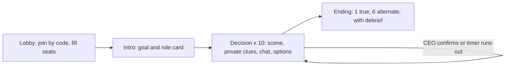

- **Lobby.** The first player is the team leader. Others join with a 4-letter code. The leader can fill empty seats with practice teammates, so one person can play alone.
- **Roles.** Drawn at random when the leader starts the programme: one CEO, then Foresight Analyst, Field Engineer, Quality Lead and People Partner for the advisors. With fewer than five players, the missing roles' clues are shared among the advisors, so the puzzle stays solvable.
- **Each decision.** Everyone sees the scene and three options. Each advisor sees only their own clue. Advisors tap to suggest an option; the CEO picks and confirms.
- **Timer.** 90 seconds per decision on the server (75 in the demo). If time runs out, the most-suggested option is taken, otherwise a random one.
- **Dropped players.** A dropped player's clues move to connected advisors. If the CEO drops, the longest-connected human teammate takes over.

## 4. The story map

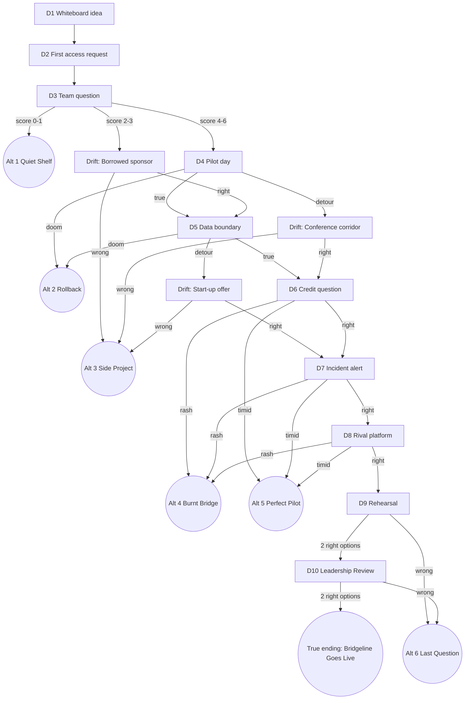

How it follows the design rules:

| Stage | Rule | What happens |
| --- | --- | --- |
| D1-D3 | Every pick is worth 2, 1 or 0 points (hidden) | Total 0-1 ends early, 2-3 enters a drift node, 4-6 stays on the main track |
| D4-D5 | One doom, one true, one detour | Doom ends the game; the detour is a drift node that can rejoin the main track |
| D6-D8 | One right, two wrong | The two wrong options lead to different endings (rash, timid) |
| D9-D10 | Two right, one wrong | Either right option continues; the wrong one ends the game |
| Drift nodes | One right, two wrong | Right rejoins the main track; wrong ends the game |

Every route to the true ending is exactly 10 decisions, because a drift node replaces the main node it skips.

## 5. How it is built

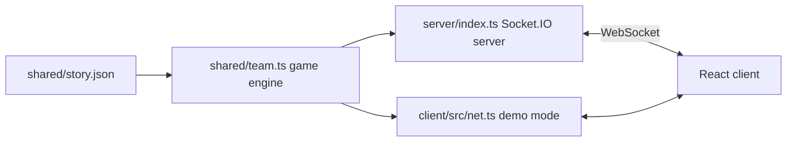

The key idea: **one game engine, two hosts.** `shared/team.ts` is a plain TypeScript class that runs one team's game and never touches the network. The real server runs it behind Socket.IO. The browser demo runs the same class inside the page. That is why the demo is a faithful preview and why the checks below test the real rules.

| Path | Role |
| --- | --- |
| `shared/story.json` | The whole story: 13 decision nodes, 7 endings, 4 role clues per node (all fictional; the company name appears only in the title, goal and intro) |
| `shared/team.ts` | The engine: roles, clues, timer, scoring, chat, practice bots, and what each player may see |
| `shared/types.ts` | Shared types and role names |
| `server/index.ts` | Node + Socket.IO server; also serves the built client; `/api/status` shows live counts |
| `client/src/App.tsx` | The whole UI: welcome, lobby, intro, decision, ending, chat |
| `client/src/net.ts` | Chooses Socket.IO (real) or the in-browser engine (demo) |
| `server/lint-story.ts`, `sim.ts`, `loadtest.ts` | Story checker, game simulator, socket load test |

Messages between client and server are few:

| Client sends | Meaning |
| --- | --- |
| `join` | Name, team code (or none to create a team), and a saved token so a refresh rejoins the same seat |
| `chat` | A message (max 200 characters, one per 0.8 seconds) |
| `suggest` / `choose` | An advisor's suggestion / the CEO's decision |
| `start` / `skip` / `bots` | Leader sets out / skips the intro / fills seats with practice teammates |

The server answers with `state` (that player's own view), `chat`, `chatlog`, `joined` and `error`.

## 6. How secrets stay secret

The engine builds a separate view for every player. A view contains the scene, the three option labels, suggestion counts, and only the clues that player holds. It never contains which option is right, option categories, the hidden Chapter 1 score, or other players' clues. The simulator checks this on every decision of thousands of games and found no leaks. This only works because the server decides everything; the browser just displays what it is sent.

## 7. What has been checked

| Check | Command | Result |
| --- | --- | --- |
| Types | `npm run typecheck` | Passes |
| Story structure | `npm run lint:story` | 13 nodes, 7 endings, no dead ends, every true-ending route is 10 decisions, no clue repeats the right option's label |
| Game simulation | `npm run sim` | All 7 endings reachable; no secrets in any view; all four clues always available for teams of 1 to 5; true ending reached in about 13% / 20% / 31% / 50% / 70% of games at skill 0.5 / 0.6 / 0.7 / 0.8 / 0.9 |
| Full playthrough in a browser | headless run | A full winning game through the real UI, no errors |
| Local load | `npm run loadtest` | 200 sockets (40 teams) chatting every 5 seconds, no drops, p95 delay 12 ms |

The simulation assumes a team spots the best option with a fixed probability. Real teams will behave differently, so treat the percentages as a starting point for tuning, not a prediction.

## 8. What is real, what is simplified, what is missing

**Real:** multiplayer teams and chat over WebSockets, the full rule set and the Bridgeline story, private clues, CEO handover, practice teammates, the single-file demo, and the checks above.

**Simplified:**
- Practice teammates are scripted bots. They post their clue (with a role-flavoured prefix such as "Per the quality record:") and suggest the best option with a set probability. They are not an AI.
- Game state lives in server memory, so restarting the server ends running games.
- The profanity filter is a tiny placeholder list.
- The server timer is 90 seconds; the plan assumed about 105 including reading time.

**Not built yet:**
- A content generator and review step for writing text with a local model (the story was written by hand).
- Review of the Bridgeline text by someone who knows the real organisation, for tone, sensitivities and any wording that should not appear in a company event.
- Several wordings per clue, so neighbouring teams cannot copy each other (the data format allows it; most clues have one wording).
- Narration that reacts to the previous choice beyond a one-line aftermath.
- A host console, state saved across restarts, and any deployment to a real host.
- The future "ask the Guide" feature. Nothing in the prototype takes player text to a model.
- Playtesting with people. The clue difficulty is a first draft.

## 9. Trying it yourself

- **Browser demo:** open `docs/index.html` (or the GitHub Pages link).
- **Real multiplayer on your machine:** `npm install`, `npm run build`, `npm start`, then open http://localhost:3000 in several tabs. Use `DECISION_SECONDS=30 npm start` for faster rounds.
- **Change the story:** edit `shared/story.json`, run `npm run lint:story` and `npm run sim`, then `npm run demo:docs` to refresh the demo page.

## 10. Planned: Revision 6 (not built yet)

*Revision 7 (section 11) replaces the preset feed and the 18 s + 75 s timing below.*

Feedback said the text was too complex and too high fantasy, so the plan changes how a scene is shown, how teammates talk and who the roles are. The graph, rules and clue secrecy stay the same.

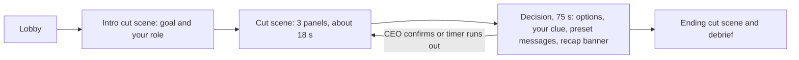

| Today | Planned |
| --- | --- |
| Scene is a paragraph of text | Scene is a 3-panel cut scene: one picture and one short caption per panel |
| Free-text team chat | Read-only team feed: preset messages ("Let's meet up in 5 minutes to discuss", "I suggest option 2") and "Share my clue" |
| No way to re-read a scene | Banner at the top opens a recap card: key picture, short text recap, the goal |
| Warden, Seer, Scout, Loremaster, Heartspeaker | CEO, Product Lead, Lead Dev, QA Lead, Customer Lead |
| Placeholder-style story text | Plain-language story with hard word limits and a reading-ease check |
| 90-second decision | About 18-second cut scene, then 75 seconds; a full run is about 17 minutes |

Pictures are composed from a small kit of backgrounds, characters, props and moods (vector graphics), so they are free, tiny and work in the single-file demo. The server accepts only preset ids, so no free text reaches it except player names. Full detail is in the Revision 6 section of the Feasibility & MVP Plan.

When Revisions 6 and 7 are built, update sections 1-9 above; until then they are accurate for the current prototype.

## 11. Planned: Revision 7 (not built yet)

Teams will sit together, so the game becomes a series of short in-person huddles, like mini stand-ups. The number of decisions drops from 10 to 6, and each one is longer and a bit more complex. The pictures, the recap banner, the roles and the plain language from Revision 6 stay; the preset feed and the timing do not.

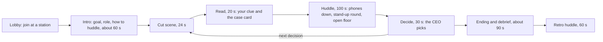

In the stand-up round each advisor says what they see (their fact), what worries them (their role-biased concern) and what they would do. The CEO listens, then there is 20 seconds of open floor.

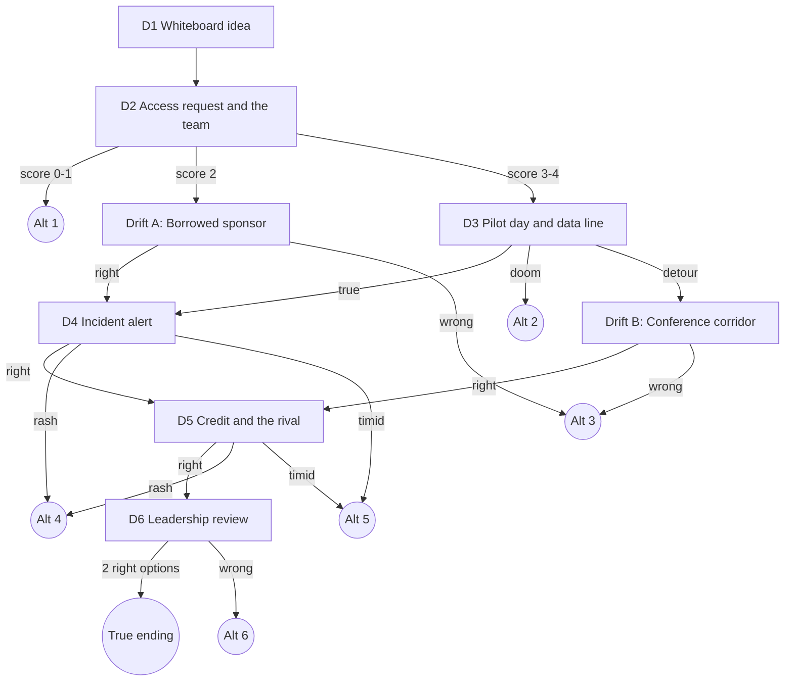

Every route to the true ending is exactly 6 decisions, because a drift node replaces the main node it skips.

| Today | Planned |
| --- | --- |
| 10 decisions, about 20 minutes | 6 decisions, still about 20 minutes |
| About 93-105 seconds per decision | About 174 seconds: cut scene, read, huddle, decide |
| Team chat | No in-app messaging; teams talk face to face in a stand-up round |
| One clue per advisor | A fact and a worry per advisor, plus a case card of three public facts |
| Options are short labels | Each option shows a gain and a cost |
| Join by typing a 4-letter code | Join at a numbered station with a printed code card and QR |
| The game ends at the debrief | An optional 60-second retro huddle |

Six decisions make the true ending easier at the same skill level: in my model 37% of teams at skill 0.6 reach it, against 21% with ten decisions. So the richer clues are what keep it hard. The practice teammates in the demo will "speak" their lines as speech bubbles, so one person can still try the whole game alone. Full detail, including the open decisions H1-H9, is the Revision 7 section of the Feasibility & MVP Plan.
